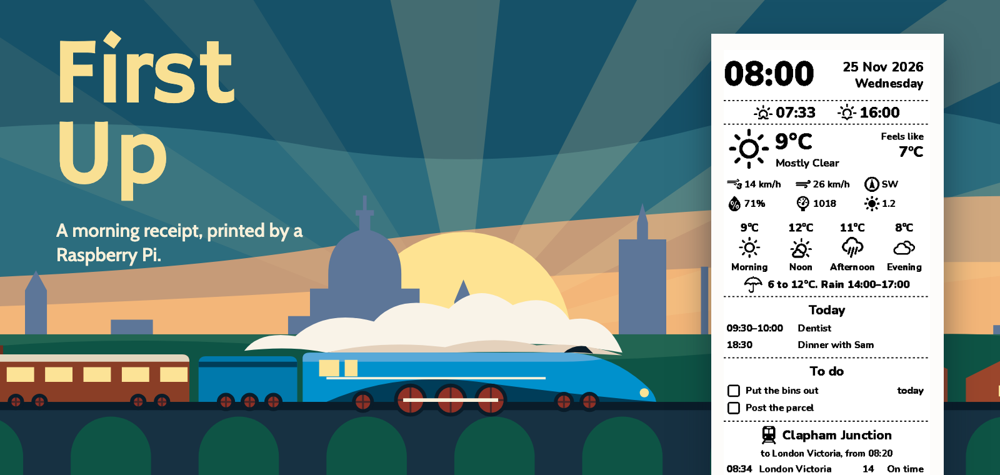
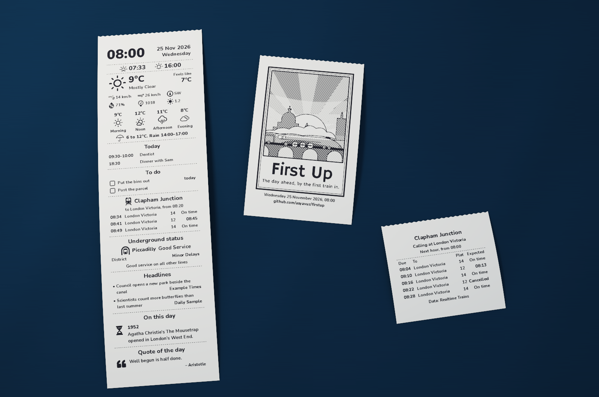
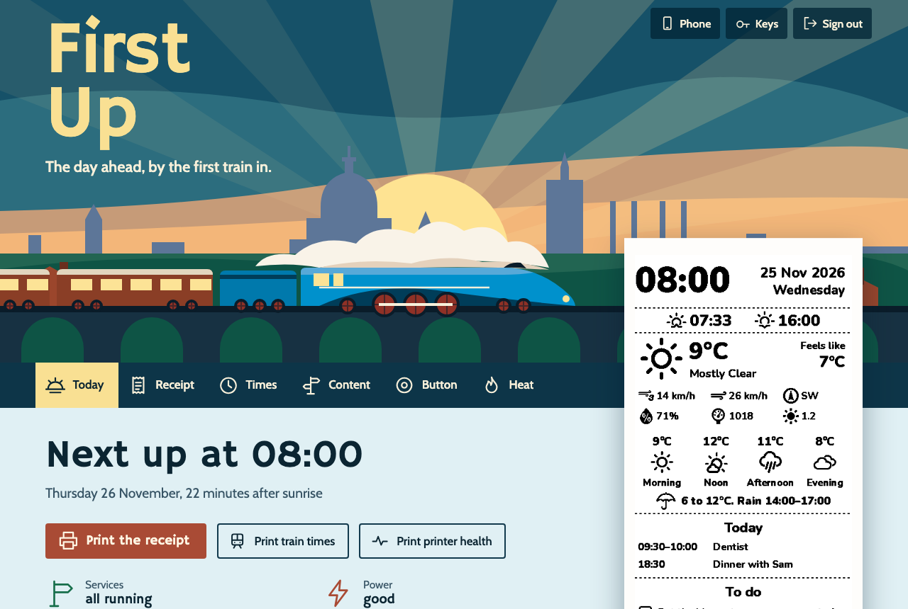
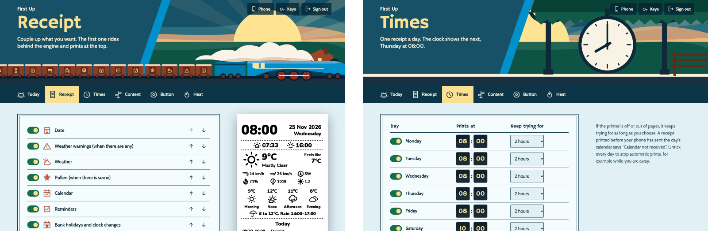

# First Up

A Raspberry Pi with a small thermal printer. At eight in the morning it prints one strip of
paper with the weather, your calendar, the trains you could catch and the headlines. A
button prints it again, or prints something else.

In railway language *up* is towards London. It is also what you are when you read it. The
trains, the Underground, the weather warnings and the bank holidays (England and Wales) are
British, and pollen is European. The rest works anywhere, and every block can be left out.

## What it can print

| Block | Name | From |
|---|---|---|
| Date and time | `header` | the Pi |
| Weather warnings, when there are any | `warnings` | Met Office |
| Weather: now, the day, rain, strong sun | `weather` | Open-Meteo |
| Pollen, on days there is some | `pollen` | Open-Meteo |
| Calendar | `events` | your iPhone |
| Reminders | `reminders` | your iPhone |
| Bank holidays and clock changes | `ahead` | gov.uk, the time zone |
| My trains: the next few you can catch | `trains` | Realtime Trains |
| Underground status | `tube` | TfL |
| Weekend closures, on Fridays | `weekend` | TfL |
| Headlines | `news` | RSS feeds you choose |
| On this day | `history` | Wikipedia |
| Quote of the day | `quote` | ZenQuotes |
| "Have a fabulous day!" | `closing` | the Pi |
| Sudoku, in three strengths | `sudoku` | made on the Pi |
| Train times, the whole hour | `departures` | Realtime Trains |
| Printer health | `health` | the Pi |
| Wi-Fi name, password, QR code | `wifi` | the Pi |
| First Up poster | `poster` | a picture, below |

Any of them, in any order, can be on the daily receipt. Any of them can also have a press of
the button: one to nine taps, or holding for one to four seconds. Holding for five seconds
always shuts the Pi down safely.

Only the trains need a token, a free one. If a source is down, its block says "unavailable"
and the rest still prints.

Not a photograph, but drawn from exactly what the printer is sent. Everything on it is made up.

## The web interface

Everything in these pictures is made up.

It chooses what is printed and when, what the button does and how dark it prints, shows a
preview without using paper, and prints. It is optional, works on a phone, uses no scripts
and nothing from outside, and can be reached only from the home network, over HTTPS and with
a password.

## Start here

| Guide | What it covers |
|---|---|
| [Installing](docs/install.md) | from bare parts to the first receipt |
| [Hardware](docs/hardware.md) | wiring, power, print quality |
| [Calendar and reminders](docs/calendar.md) | a name, a certificate and an iPhone shortcut (optional) |
| [Web interface](docs/web.md) | setting it up, how it works, how it is kept safe (optional) |
| [A new SD card](docs/rebuild.md) | what to keep and what to do again |

You need a Raspberry Pi (built and tested on a 3B+), a 58 mm thermal printer with a serial
port, and a Mac or Linux computer to install from. The calendar, the reminders and the web
interface also need a domain name, and the first two an iPhone.

## Privacy

- The Pi never has a calendar login. The phone sends one day's lists. They wait on the Pi as
  two small files, and are deleted soon after that day is over (or when the Pi next runs).
  Titles go on paper and nowhere else: not into the log, not into previews, which show
  examples.
- Anybody who can press the button can print today's calendar, and the Wi-Fi password if you
  stored it. If that does not suit you, give Wi-Fi no press, and take the calendar off the
  receipt or the receipt off the button. Wi-Fi on the daily receipt prints the password every
  day.
- The Wi-Fi password and the train token are kept in files only one account can read.
- The sources see your home's internet address, the program's name (`receipt-reporter`) and
  what is asked for: the weather place to about a kilometre, the warnings region, a train
  station, a destination and the time, the kinds of Underground line, and the feeds. Realtime
  Trains also sees whose token it is. Whether there is a network is tested by connecting to
  the weather site. The program reports to nobody else.
- The log on the Pi keeps a month: what was printed when, which device on your network signed
  in or sent a list, never what was in it.
- The calendar and the web interface need a public name. That name, and the number it leads
  to on your home network, become public; see [calendar.md](docs/calendar.md).
- Nothing is open to the internet. See *Safety* in the [web](docs/web.md) and
  [calendar](docs/calendar.md) guides for what protects it at home.

## How it works

    iPhone   --calendar, reminders-->  drop box  ---------.
    browser  ----------------------->  web interface  ----+-->  reporter  -->  printer
    button   ---------------------------------------------|
    timer, every five minutes  ---------------------------'

`reporter.timer` runs `reporter scheduled` every five minutes. It prints if it is a listed
day, between the time and the cut-off, and the daily receipt has not come yet; first it waits
for a clock that is right (a Pi has no battery clock). If the printer is off or out of paper
it tries again until the cut-off. The drop box and the web interface are small programs with
their own accounts and sandboxes, using Python's standard library only.

A successful line in the log means the printer answered, not that the paper looks right.
Only eyes can tell.

    reporter/            the program
      sections/          one file per block: fetch() gets the data, render() draws it
    reporter_web/        the web interface
    deploy/              systemd units, installation scripts, calendar drop box
    deploy.sh            copies the program to the Pi and installs it
    tools/               draws the pictures that are kept as files
    tests/               run without any hardware

**To add a block:** make `reporter/sections/<name>.py` with `fetch` and `render` (return None
to leave it out today). Add it to `REGISTRY` in `sections/__init__.py` and to `SECTIONS` in
`settings.py`, and draw an icon for it in `reporter_web/art.py`. If it is
private, give it an `example` and add it to `PRIVATE` in `report.py`. To look at it:
`.venv/bin/python -m reporter render <name>`. The tests say what is missing. Then list it in
`sections` (or switch it on under Receipt) and run `./deploy.sh`, with `--web` if the web
interface is installed.

**To run the tests** (Python 3.11 or newer):

    python3 -m venv .venv
    .venv/bin/pip install -r requirements.txt
    .venv/bin/pip install pytest
    .venv/bin/python -m pytest

**To see a receipt without any hardware:** `.venv/bin/python -m reporter render`

## Credits and licences

The program is under the [MIT licence](LICENSE). It prints data that belongs to others, for
personal use; read their terms before doing anything else with it.

- Weather and pollen by [Open-Meteo](https://open-meteo.com/) (CC BY 4.0, free for
  non-commercial use); pollen from the CAMS European ensemble, Copernicus.
- Weather warnings from the [Met Office](https://weather.metoffice.gov.uk/warnings-and-advice/uk-warnings).
- Train times by [Realtime Trains](https://www.realtimetrains.co.uk/), free for personal,
  non-commercial use; each person needs their own token.
- Powered by [TfL Open Data](https://tfl.gov.uk/info-for/open-data-users/). Contains OS data
  © Crown copyright and database rights 2016 and Geomni UK Map data © and database rights [2019].
- Bank holidays from [gov.uk](https://www.gov.uk/bank-holidays), Open Government Licence.
- On this day from [Wikipedia](https://en.wikipedia.org/wiki/Wikipedia:Selected_anniversaries), CC BY-SA.
- Inspirational quotes provided by [ZenQuotes API](https://zenquotes.io/).
- Stations (`reporter/stations.csv`) from
  [uk-railway-stations](https://github.com/davwheat/uk-railway-stations) by davwheat and
  [Trainline EU](https://github.com/trainline-eu/stations#licence) and its sources, Open
  Database Licence.
- Fonts: Nunito, Hammersmith One and Cabin, SIL Open Font Licence (next to each).
- Weather icons: [Weather Icons](https://erikflowers.github.io/weather-icons/), designs
  originally by Lukas Bischoff, from v1.1 by Erik Flowers, SIL Open Font Licence (next to
  them). The other icons, and the posters, are drawn in code.
- Libraries, installed from PyPI and not part of this repository:
  [Pillow](https://python-pillow.github.io/) (MIT-CMU),
  [Requests](https://requests.readthedocs.io/) (Apache 2.0) with urllib3 (MIT), certifi
  (MPL 2.0), charset-normalizer (MIT) and idna (BSD),
  [pySerial](https://github.com/pyserial/pyserial) (BSD) and
  [Segno](https://github.com/heuer/segno) (BSD). From Debian:
  [gpiozero](https://gpiozero.readthedocs.io/) and lgpio for the button, and
  [Certbot](https://certbot.eff.org/) for the certificate from
  [Let's Encrypt](https://letsencrypt.org/).
